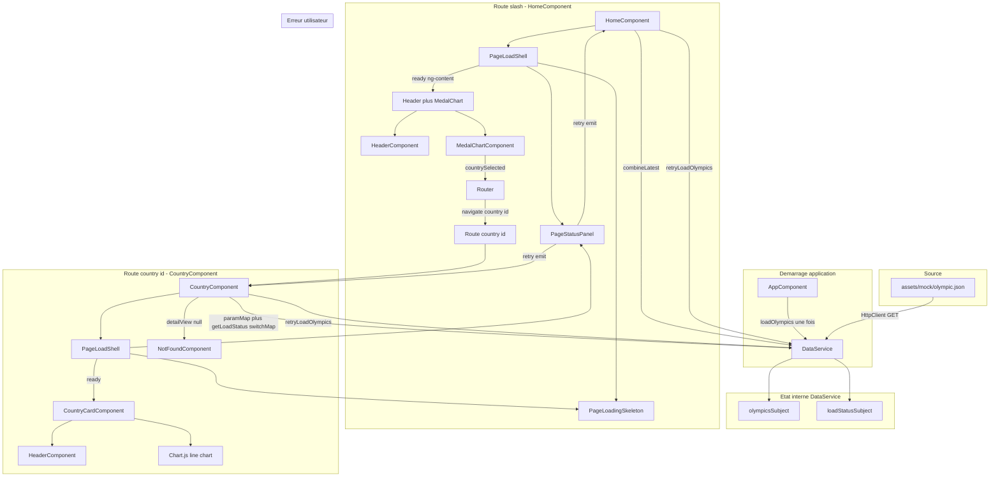

# Architecture front-end — TéléSport

Application Angular 18 (NgModule) affichant un tableau de bord des médailles olympiques par pays et une page de détail par pays. Les données proviennent aujourd’hui d’un mock JSON ; toute la logique métier et d’accès aux données est centralisée dans un service unique.

---

## Arborescence `src/app/`

```
src/app/
├── app.component.*          # Shell : router-outlet + préchargement des données
├── app.module.ts            # Module racine, HttpClient, routing
├── app-routing.module.ts    # Routes de l’application
├── models/                  # Contrats TypeScript (domaine + vues)
├── services/
│   └── data.service.ts      # Source de vérité des données (singleton)
├── components/              # Composants réutilisables (standalone)
│   ├── header/
│   ├── medal-chart/
│   ├── country-card/
│   ├── page-load-shell/
│   ├── page-loading-skeleton/
│   └── page-status-panel/
└── pages/                   # Écrans routés
    ├── home/
    ├── country/
    └── not-found/
```

Les assets mock restent dans `src/assets/mock/olympic.json`. Les styles globaux (grille responsive, boutons, squelettes) sont dans `src/styles.scss`.

---

## Modèles (`models/`)

| Fichier | Rôle |
| --- | --- |
| `participation.ts`, `olympic.ts` | Structure du JSON (contrat domaine). |
| `indicator.ts` | KPI affiché dans l’en-tête (`label` + `value`). |
| `chart-data.ts` | Données prêtes pour Chart.js (`PieChartData` inclut `countryIds` pour la navigation). |
| `dashboard-view.ts` | Vue agrégée du dashboard (KPI + pie). |
| `country-detail-view.ts` | Vue agrégée du détail pays (titre, KPI, line). |
| `data-load-status.ts` | Union `loading` \| `ready` \| `empty` \| `error` pour l’UI de chargement. |

Les pages et composants graphiques consomment surtout les **vues** (`DashboardView`, `CountryDetailView`), pas le JSON brut.

---

## Service `DataService`

- **Fichier :** `services/data.service.ts`
- **Enregistrement :** `@Injectable({ providedIn: 'root' })` — une seule instance pour toute l’app (singleton).
- **Responsabilités :**
  - Charger `./assets/mock/olympic.json` via `HttpClient` (**une seule fois**, déclenché par `AppComponent`).
  - Mettre en cache le résultat dans un `BehaviorSubject` (`null` = pas encore chargé).
  - Calculer KPI et séries pour les graphiques (aucune agrégation métier dans les composants d’affichage).

| Méthode | Usage |
| --- | --- |
| `loadOlympics()` | Déclenche le HTTP (idempotent). **Uniquement** depuis `AppComponent`. |
| `retryLoadOlympics()` | Relance le HTTP après une erreur (ou un état vide) : remet le cache à `null`, passe en `loading`, puis met à jour le statut. Appelé depuis les pages (bouton Try again). |
| `getOlympics()` | Observable du cache : `Olympic[]` ou `null` (en attente). |
| `getDashboardView()` | KPI dashboard + `PieChartData` ; `null` si cache vide ou pas prêt. |
| `getCountryDetailView(id)` | `CountryDetailView` ou `null` (cache non prêt, données vides, ou pays inconnu). |
| `parseCountryRouteId(param)` | Valide le paramètre de route `:id` (nombre fini ou `null`). |
| `getLoadStatus()` | `loading` \| `ready` \| `empty` \| `error` — état du chargement mock (sans message technique). |

Les pages **n’appellent pas** `loadOlympics()` au démarrage : elles s’appuient sur `getLoadStatus()` et les vues dérivées. En cas d’erreur affichée, elles peuvent appeler **`retryLoadOlympics()`**.

**Test erreur (dev)** : `environment.simulateOlympicsLoadError = true` force une URL mock invalide pour vérifier l’UI d’erreur.

---

## Composants réutilisables (`components/`)

| Composant | Selector | Rôle |
| --- | --- | --- |
| **HeaderComponent** | `app-header` | Titre (`h1`) + liste d’indicateurs (KPI). Inputs : `title`, `indicators`. |
| **MedalChartComponent** | `app-medal-chart` | Pie chart (Chart.js) + tableau pays / médailles / « View details ». Inputs : `chartData`, `description`. Output : `countrySelected` (id pays). |
| **CountryCardComponent** | `app-country-card` | Header + line chart. Input : `detailView`. |
| **PageLoadShellComponent** | `app-page-load-shell` | Enveloppe **loading / empty / error / ready** : compose skeleton + status panel ; contenu métier projeté via `<ng-content>` quand `loadState === 'ready'`. |
| **PageLoadingSkeletonComponent** | `app-page-loading-skeleton` | Squelette (titre, KPI, chart). Inputs : `statusMessage`, `kpiCount` ; `showIntroLine` optionnel (non utilisé). |
| **PageStatusPanelComponent** | `app-page-status-panel` | États **empty** / **error** partagés. Inputs : `variant`, `message`, libellés retry. Output : `retry`. |

Composants **standalone**. `AppModule` importe `HeaderComponent`, `MedalChartComponent`, `CountryCardComponent`, `PageLoadShellComponent` (ce dernier importe skeleton + status panel). Aucun HTTP dans les composants d’affichage ; le retry est déclenché par la page via `DataService`.

---

## Pages (`pages/`)

| Route | Composant | Rôle |
| --- | --- | --- |
| `''` | `HomeComponent` | `PageLoadShell` + `getLoadStatus()` / `getDashboardView()` ; header + pie ; navigation → `/country/:id`. |
| `country/:id` | `CountryComponent` | `PageLoadShell` + `getLoadStatus()` ; `parseCountryRouteId` + `getCountryDetailView(id)` ; `CountryCard` ; id invalide ou pays inconnu → `/not-found` (dans le composant). |
| `not-found`, `**` | `NotFoundComponent` | Message utilisateur + lien retour dashboard. |

Bouton **Back to Dashboard** (`routerLink="/"`) : page **détail pays** (hors shell) et **not-found**. Le dashboard n’a pas de bouton retour.

---

## Flux de données (résumé)



### Vue d’ensemble

Toute l’application repose sur **un cache en mémoire** dans `DataService` (liste `Olympic[]` ou `null`) et un **statut de chargement** (`DataLoadStatus`). Les composants d’affichage ne parlent jamais à `HttpClient` directement : ils observent le service et affichent des **vues** déjà calculées (`DashboardView`, `CountryDetailView`).

### 1. Démarrage et chargement du mock

1. L’utilisateur ouvre l’app → le routeur affiche `HomeComponent` (ou une autre route).
2. **`AppComponent.ngOnInit`** appelle **`loadOlympics()`** une seule fois.
3. `DataService` passe le statut à **`loading`**, effectue le GET vers `olympic.json`, puis :
   - succès avec données → cache rempli, statut **`ready`** ;
   - tableau vide → cache `[]`, statut **`empty`** ;
   - échec HTTP → cache `null`, statut **`error`**.
4. Si le cache est déjà rempli (navigation ultérieure sans retry), `loadOlympics()` ne refait pas le réseau : il republie le statut adapté.

### 2. Rôle des observables du service

| Observable | Contenu | Consommateur principal |
| --- | --- | --- |
| `getLoadStatus()` | `loading` \| `ready` \| `empty` \| `error` | `HomeComponent`, `CountryComponent` → input `[loadState]` de **`PageLoadShell`** |
| `getDashboardView()` | KPI + `PieChartData` ou `null` | **`HomeComponent`** uniquement |
| `getCountryDetailView(id)` | Titre, KPI, `LineChartData` ou `null` | **`CountryComponent`** (après lecture de `:id`) |
| `getOlympics()` | Cache brut (peu utilisé par les pages directement) | Base des vues dérivées dans le service |

Les agrégations (nombre de pays, nombre d’éditions, totaux médailles, séries pour Chart.js) sont calculées **dans le service** au moment de construire les vues.

### 3. Dashboard (`HomeComponent`)

1. Au `ngOnInit`, **`combineLatest([getLoadStatus(), getDashboardView()])`** met à jour `pageState` et, si `ready`, les propriétés `indicators`, `pieChart`, `chartDescription`.
2. Le template enveloppe tout dans **`PageLoadShell`** :
   - **`loading`** → **`PageLoadingSkeleton`** (2 KPI, chart) ;
   - **`empty`** / **`error`** → **`PageStatusPanel`** (Try again → **`retryLoadOlympics()`** sur la page) ;
   - **`ready`** → contenu projeté : **`HeaderComponent`** + **`MedalChartComponent`**.
3. **`MedalChartComponent`** reçoit `PieChartData` (labels, values, **countryIds**). Clic sur un secteur ou bouton « View details » du tableau → **`countrySelected`** → `Router.navigate(['country', id])`.

Aucun bouton « Back to Dashboard » sur l’accueil.

### 4. Détail pays (`CountryComponent`)

1. **`combineLatest([paramMap → parseCountryRouteId, getLoadStatus()])`** puis **`switchMap`** :
   - statut `loading` / `error` / `empty` → shell seul, pas de requête de détail ;
   - statut `ready` + id valide → **`getCountryDetailView(id)`** ;
   - id invalide → navigation **`/not-found`** (sans guard dédié aujourd’hui).
2. Même **`PageLoadShell`** que l’accueil (skeleton à **3** KPI côté country).
3. En **`ready`**, **`CountryCardComponent`** affiche **`HeaderComponent`** (titre = nom du pays) + courbe Chart.js à partir de `detailView.lineChart`.
4. Si la vue détail est `null` (pays absent du mock) → redirection **`/not-found`**.
5. Sous la grille : lien **Back to Dashboard** (`routerLink="/"`), hors shell.

### 5. Page introuvable

**`NotFoundComponent`** : message statique + retour dashboard. Route explicite `/not-found` ou wildcard `**`.

### 6. Rechargement après erreur

Sur **`PageStatusPanel`** (variant error), **Try again** remonte l’événement **`retry`** → la page appelle **`retryLoadOlympics()`** : cache invalidé, statut **`loading`**, nouveau GET. Les abonnements existants (`combineLatest` / `switchMap`) réagissent et mettent à jour le shell puis le contenu **sans** rappeler `loadOlympics()` depuis `AppComponent`.

---

## UI, responsive et accessibilité

- Grille **4 / 8 / 12 colonnes** (mobile / tablette / desktop) via `.page-grid`.
- États **loading / empty / error / ready** centralisés via **`PageLoadShell`** sur home et country ; erreur → **Try again** (`retryLoadOlympics`).
- Pas de paragraphe d’intro au-dessus du bandeau (contenu direct : header + graphiques).
- Graphiques : conteneur `.chart-canvas-host` (Chart.js gère le ratio ; pas de `width`/`height` forcés sur le canvas).
- Accessibilité : focus visible, description cachée du camembert, **tableau** des pays sous le pie (navigation clavier / lecteur d’écran).

---

## Évolutions prévues (back-end / API)

La connexion à une API REST ne devrait toucher **que** `DataService` :

1. Remplacer l’URL du mock par les endpoints REST.
2. Adapter la réponse vers `Olympic` / `Participation` (Adapter si le JSON diffère).
3. Conserver les méthodes de vue (`getDashboardView`, `getCountryDetailView`) : les pages restent stables.

Améliorations possibles : guard de route pour le 404 pays, invalidation de cache, tests unitaires (`DataService`, pages).

---

## Stack et conventions

- **Angular 18**, NgModule (`AppModule`), routing classique.
- **RxJS** : `Observable`, `combineLatest`, `switchMap`, `takeUntilDestroyed` dans les pages.
- **Chart.js** dans `MedalChartComponent` et `CountryCardComponent`.
- Typage strict : pas de `any` dans `src/app`.
- Totaux médailles : champ mock `medalsCount` (pas de décomposition or/argent/bronze).

---

## Pour reprendre le projet

1. `npm install` puis `npm start` (`ng serve`).
2. Données : `DataService` ; chargement initial dans `AppComponent`.
3. Nouvel écran : page sous `pages/`, route, abonnement à une vue du service.
4. Nouveau bloc UI : `ng generate component components/...` (standalone), import dans `AppModule`.
