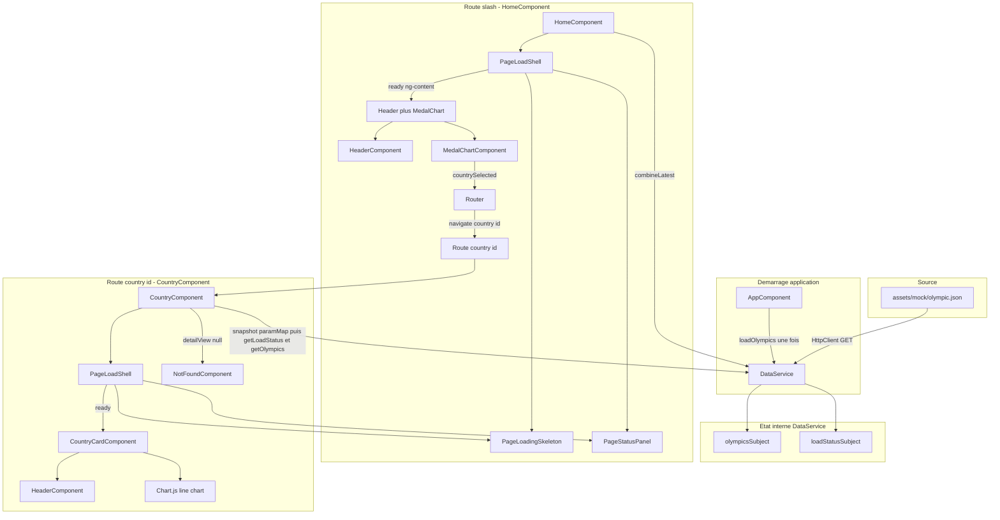

# Architecture front-end — TéléSport

Application Angular 18 (NgModule) affichant un tableau de bord des médailles olympiques par pays et une page de détail par pays. Les données proviennent aujourd’hui d’un mock JSON. L’accès aux données (chargement HTTP, cache, statut) est centralisé dans un service unique (`DataService`) ; la logique métier de construction des vues (indicateurs, données de graphique) est portée par les **composants de page** (`HomeComponent`, `CountryComponent`).

---

## Arborescence `src/app/`

```
src/app/
├── app.component.*          # Shell : router-outlet + préchargement des données
├── app.module.ts            # Module racine, HttpClient, routing
├── app-routing.module.ts    # Routes de l’application
├── models/                  # Contrats TypeScript (domaine + vues)
├── services/
│   └── data.service.ts      # Source de vérité des données (singleton)
├── components/              # Composants réutilisables (standalone)
│   ├── header/
│   ├── medal-chart/
│   ├── country-card/
│   ├── page-load-shell/
│   ├── page-loading-skeleton/
│   └── page-status-panel/
└── pages/                   # Écrans routés
    ├── home/
    ├── country/
    └── not-found/
```

Les assets mock restent dans `src/assets/mock/olympic.json`. Les styles globaux (grille responsive, boutons, squelettes) sont dans `src/styles.scss`.

---

## Modèles (`models/`)

| Fichier | Rôle |
| --- | --- |
| `participation.ts`, `olympic.ts` | Structure du JSON (contrat domaine). |
| `indicator.ts` | KPI affiché dans l’en-tête (`label` + `value`). |
| `chart-data.ts` | Données prêtes pour Chart.js (`PieChartData` inclut `countryIds` pour la navigation). |
| `country-detail-view.ts` | Vue agrégée du détail pays (titre, KPI, line), construite par `CountryComponent`. |
| `data-load-status.ts` | Union `loading` \| `ready` \| `empty` \| `error` pour l’UI de chargement. |

Le **dashboard** n’a pas de vue agrégée dédiée : `HomeComponent` expose directement `indicators` (`Indicator[]`) et `pieChart` (`PieChartData`) comme propriétés distinctes. Le **détail pays** reste porté par `CountryDetailView` (consommée telle quelle par `CountryCardComponent`), mais elle est désormais **construite dans `CountryComponent`**, pas dans le service. Les composants graphiques (`MedalChartComponent`, `CountryCardComponent`) consomment ces vues/données déjà prêtes, jamais le JSON brut.

---

## Service `DataService`

- **Fichier :** `services/data.service.ts`
- **Enregistrement :** `@Injectable({ providedIn: 'root' })` — une seule instance pour toute l’app (singleton).
- **Responsabilités :**
  - Charger `./assets/mock/olympic.json` via `HttpClient` (**une seule fois**, déclenché par `AppComponent`).
  - Mettre en cache le résultat dans un `BehaviorSubject` (`null` = pas encore chargé).
  - Exposer les données brutes (`Olympic[]`) et le statut de chargement. **Aucune agrégation métier** (KPI, séries de graphique) côté service : cette construction de vue est désormais faite par les **pages**.

| Méthode | Usage |
| --- | --- |
| `loadOlympics()` | Déclenche le HTTP (idempotent) ; si une erreur a déjà été rencontrée, ne retente pas le réseau. **Uniquement** depuis `AppComponent`. |
| `getOlympics()` | Observable du cache : `Olympic[]` ou `null` (en attente / erreur). Source unique utilisée par `HomeComponent` et `CountryComponent` pour construire leurs vues. |
| `parseCountryRouteId(param)` | Valide le paramètre de route `:id` (nombre fini ou `null`). |
| `getLoadStatus()` | `loading` \| `ready` \| `empty` \| `error` — état du chargement mock (sans message technique). |

Les pages **n’appellent pas** `loadOlympics()` au démarrage : elles s’appuient sur `getLoadStatus()` et `getOlympics()`. Il n’y a **pas de mécanisme de retry** : en cas d’erreur, le statut reste `error` tant que l’application n’est pas rechargée (pas de bouton « Try again »).

**Test erreur (dev)** : `environment.simulateOlympicsLoadError = true` force une URL mock invalide pour vérifier l’UI d’erreur.

---

## Composants réutilisables (`components/`)

| Composant | Selector | Rôle |
| --- | --- | --- |
| **HeaderComponent** | `app-header` | Titre (`h1`) + liste d’indicateurs (KPI). Inputs : `title`, `indicators`. |
| **MedalChartComponent** | `app-medal-chart` | Pie chart (Chart.js) + tableau pays / médailles / « View details ». Inputs **Signal** (`input()`) : `chartData`, `description`. Output **Signal** (`output()`) : `countrySelected` (id pays). Reconstruction du chart pilotée par un `effect()` (plus de `ngOnChanges`). |
| **CountryCardComponent** | `app-country-card` | Header + line chart. Input : `detailView`. |
| **PageLoadShellComponent** | `app-page-load-shell` | Enveloppe **loading / empty / error / ready** : compose skeleton + status panel ; contenu métier projeté via `<ng-content>` quand `loadState === 'ready'`. |
| **PageLoadingSkeletonComponent** | `app-page-loading-skeleton` | Squelette (titre, KPI, chart). Inputs : `statusMessage`, `kpiCount` ; `showIntroLine` optionnel (non utilisé). |
| **PageStatusPanelComponent** | `app-page-status-panel` | États **empty** / **error** partagés (message seul, pas d’action). Inputs : `variant`, `message`. |

Composants **standalone**. `AppModule` importe `HeaderComponent`, `MedalChartComponent`, `CountryCardComponent`, `PageLoadShellComponent` (ce dernier importe skeleton + status panel). Aucun HTTP ni calcul d’agrégat métier dans les composants d’affichage : ils reçoivent des données/vues déjà prêtes via leurs `@Input()` (ou `input()`/`output()` pour `MedalChartComponent`), construites par la page parente.

`MedalChartComponent` est le seul composant migré vers l’API **Signals** (`input()`, `output()`, `effect()`) ; les autres composants réutilisables utilisent encore les décorateurs `@Input()`/`@Output()` classiques.

---

## Pages (`pages/`)

| Route | Composant | Rôle |
| --- | --- | --- |
| `''` | `HomeComponent` | `PageLoadShell` + `getLoadStatus()` / `getOlympics()` ; construit `indicators` + `pieChart` ; header + pie ; navigation → `/country/:id`. |
| `country/:id` | `CountryComponent` | `PageLoadShell` + `getLoadStatus()` ; `parseCountryRouteId` + `getOlympics()` (recherche par id) ; construit `CountryDetailView` ; `CountryCard` ; id invalide ou pays inconnu → `/not-found` (dans le composant). |
| `not-found`, `**` | `NotFoundComponent` | Message utilisateur + lien retour dashboard. |

Bouton **Back to Dashboard** (`routerLink="/"`) : page **détail pays** (hors shell) et **not-found**. Le dashboard n’a pas de bouton retour.

---

## Flux de données (résumé)



### Vue d’ensemble

Toute l’application repose sur **un cache en mémoire** dans `DataService` (liste `Olympic[]` ou `null`) et un **statut de chargement** (`DataLoadStatus`). Les composants d’affichage ne parlent jamais à `HttpClient` directement, et le service ne fait plus que charger/exposer les données brutes : ce sont les **pages** (`HomeComponent`, `CountryComponent`) qui, à partir de `Olympic[]`, calculent les indicateurs et construisent les données de graphique avant de les transmettre aux composants d’affichage via leurs `@Input()`.

### 1. Démarrage et chargement du mock

1. L’utilisateur ouvre l’app → le routeur affiche `HomeComponent` (ou une autre route).
2. **`AppComponent.ngOnInit`** appelle **`loadOlympics()`** une seule fois.
3. `DataService` passe le statut à **`loading`**, effectue le GET vers `olympic.json`, puis :
   - succès avec données → cache rempli, statut **`ready`** ;
   - tableau vide → cache `[]`, statut **`empty`** ;
   - échec HTTP → cache `null`, statut **`error`**.
4. Si le cache est déjà rempli (navigation ultérieure), `loadOlympics()` ne refait pas le réseau : il republie le statut adapté. En cas d’erreur, le statut reste `error` : il n’y a pas de nouvelle tentative automatique ni de bouton de relance.

### 2. Rôle des observables du service

| Observable | Contenu | Consommateur principal |
| --- | --- | --- |
| `getLoadStatus()` | `loading` \| `ready` \| `empty` \| `error` | `HomeComponent`, `CountryComponent` → input `[loadState]` de **`PageLoadShell`** |
| `getOlympics()` | Cache brut : `Olympic[]` ou `null` | `HomeComponent` et `CountryComponent`, qui en dérivent leurs propres vues |

Les agrégations (nombre de pays, nombre d’éditions, totaux médailles, séries pour Chart.js) sont calculées **dans les pages** (`HomeComponent.buildIndicators`/`buildPieChart`, `CountryComponent.buildCountryDetailView`), pas dans le service.

### 3. Dashboard (`HomeComponent`)

1. Au `ngOnInit`, **`combineLatest([getLoadStatus(), getOlympics()])`** met à jour `pageState` (**Signal**, `pageState.set(...)`) et, si `ready` et données non vides, construit localement `indicators` (`buildIndicators`), `pieChart` (`buildPieChart`) et `chartDescription`.
2. Le template enveloppe tout dans **`PageLoadShell`** (lu via `pageState()`) :
   - **`loading`** → **`PageLoadingSkeleton`** (2 KPI, chart) ;
   - **`empty`** / **`error`** → **`PageStatusPanel`** (message seul, pas d’action de relance) ;
   - **`ready`** → contenu projeté : **`HeaderComponent`** + **`MedalChartComponent`**.
3. **`MedalChartComponent`** reçoit `PieChartData` (labels, values, **countryIds**). Clic sur un secteur ou bouton « View details » du tableau → **`countrySelected`** → `Router.navigate(['country', id])`.

Aucun bouton « Back to Dashboard » sur l’accueil.

### 4. Détail pays (`CountryComponent`)

1. Au `ngOnInit`, l’`id` de route est lu **une seule fois** via `this.route.snapshot.paramMap` + **`parseCountryRouteId`** (pas d’abonnement : l’`id` ne change jamais pour une instance donnée du composant, puisqu’il n’existe aucune navigation `country → country` dans l’app — on repasse toujours par le dashboard). Si l’`id` est invalide → navigation immédiate **`/not-found`**.
2. Deux abonnements **indépendants** (pas de `combineLatest`/`switchMap`), chacun avec sa propre responsabilité :
   - **`getLoadStatus()`** → met à jour `pageState` (`loading` / `ready` / `empty` / `error`) ;
   - **`getOlympics()`** → dès que le cache est rempli, recherche le pays par `id` puis construit la vue via **`buildCountryDetailView(olympic)`** ; pays introuvable → navigation **`/not-found`**.
3. Même **`PageLoadShell`** que l’accueil (skeleton à **3** KPI côté country).
4. En **`ready`**, **`CountryCardComponent`** affiche **`HeaderComponent`** (titre = nom du pays) + courbe Chart.js à partir de `detailView.lineChart`.
5. Sous la grille : lien **Back to Dashboard** (`routerLink="/"`), hors shell.

### 5. Page introuvable

**`NotFoundComponent`** : message statique + retour dashboard. Route explicite `/not-found` ou wildcard `**`.

---

## UI, responsive et accessibilité

- Grille **4 / 8 / 12 colonnes** (mobile / tablette / desktop) via `.page-grid`.
- États **loading / empty / error / ready** centralisés via **`PageLoadShell`** sur home et country ; en **`error`**, message affiché sans action de relance (il faut recharger l’application).
- Pas de paragraphe d’intro au-dessus du bandeau (contenu direct : header + graphiques).
- Graphiques : conteneur `.chart-canvas-host` (Chart.js gère le ratio ; pas de `width`/`height` forcés sur le canvas).
- Accessibilité : focus visible, description cachée du camembert, **tableau** des pays sous le pie (navigation clavier / lecteur d’écran).

---

## Évolutions prévues (back-end / API)

La connexion à une API REST ne devrait toucher **que** `DataService` :

1. Remplacer l’URL du mock par les endpoints REST.
2. Adapter la réponse vers `Olympic` / `Participation` (Adapter si le JSON diffère).
3. `getOlympics()` / `getLoadStatus()` restent la même interface : les pages, qui construisent déjà leurs vues à partir de `Olympic[]`, n’ont pas à changer.

Améliorations possibles : guard de route pour le 404 pays, invalidation de cache, mécanisme de relance après erreur si besoin, tests unitaires (`DataService`, pages).

---

## Stack et conventions

- **Angular 18**, NgModule (`AppModule`), routing classique.
- **RxJS** : `Observable`, `combineLatest` (home), `takeUntilDestroyed` dans les pages.
- **Signals** : migration partielle en cours. `MedalChartComponent` utilise `input()`/`output()`/`effect()` (remplace `@Input()`/`@Output()`/`ngOnChanges`) ; `HomeComponent.pageState` utilise `signal()`. Le reste de l’app (autres composants, `DataService`) reste sur `@Input()`/`Observable`/`BehaviorSubject`.
- **Chart.js** dans `MedalChartComponent` et `CountryCardComponent`.
- Typage strict : pas de `any` dans `src/app`.
- Totaux médailles : champ mock `medalsCount` (pas de décomposition or/argent/bronze).

---

## Pour reprendre le projet

1. `npm install` puis `npm start` (`ng serve`).
2. Données : `DataService` (chargement brut + statut) ; chargement initial dans `AppComponent`. Les vues (indicateurs, données de graphique) sont construites dans les pages.
3. Nouvel écran : page sous `pages/`, route, abonnement à `getOlympics()`/`getLoadStatus()` + construction de sa propre vue si besoin.
4. Nouveau bloc UI : `ng generate component components/...` (standalone), import dans `AppModule`.
