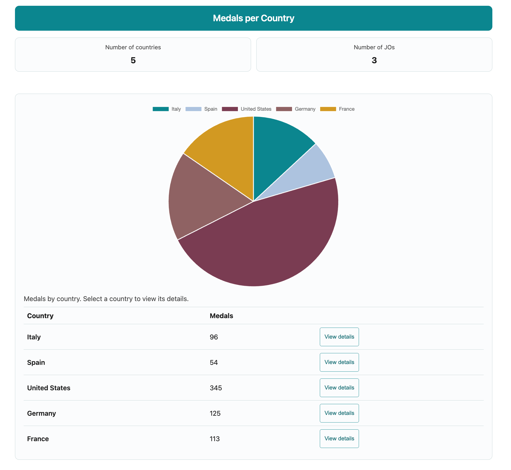
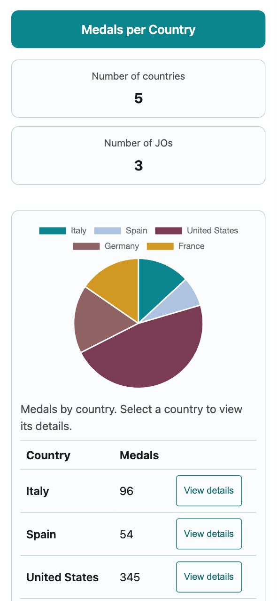
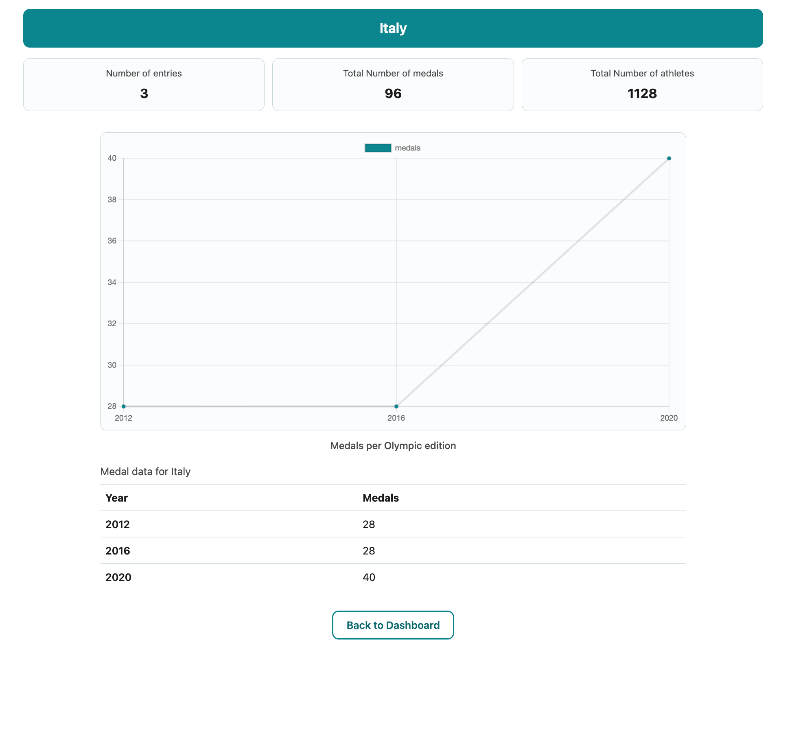
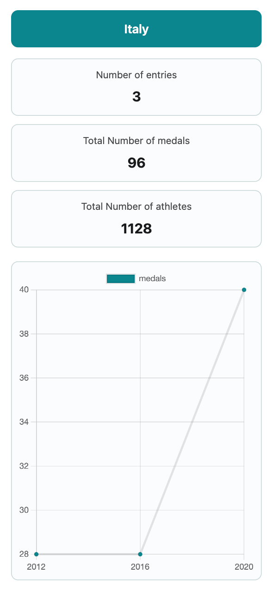

# TéléSport — médailles olympiques par pays

Application de formation **Angular 18** (projet fil rouge OpenClassrooms) : tableau de bord des médailles par pays, page de détail, navigation par identifiant, interface responsive et gestion des états loading / empty / error.

Les données proviennent d’un **mock JSON** (`src/assets/mock/olympic.json`). Toute la logique métier et les agrégations pour les graphiques passent par un unique **`DataService`**.

---

## Fonctionnalités

| Fonctionnalité | Description |
| --- | --- |
| Dashboard | KPI (pays, éditions des JO), camembert Chart.js par pays |
| Navigation | Sélection d’un pays (graphique ou tableau) → `/country/:id` |
| Détail pays | KPI (participations, médailles, athlètes), courbe des médailles par édition |
| États UI | Loading (squelettes), empty, error avec **Try again** (rechargement des données) |
| Responsive | Grille 4 / 8 / 12 colonnes (mobile, tablette, desktop) |
| Accessibilité | Textes pour lecteurs d’écran, focus visible, tableau sous le camembert |
| 404 | Route `/not-found` pour URL ou pays inconnu (redirection depuis la page détail) |

---

## Prérequis

> ⚠️ Ce projet est figé sur **Angular 18** (`package.json` : `^18.0.6`). Les plages ci-dessous sont celles exigées **par Angular 18** — elles ne garantissent pas la compatibilité avec une version d'Angular supérieure (19, 20…), qui nécessiterait une migration (`ng update`) et des tests dédiés.

- **Node.js** `^18.19.1 || ^20.11.1 || >=22.0.0` (versions supportées par Angular 18)
- **npm** `^6.11.0 || ^7.5.6 || >=8.0.0`
- **Angular CLI** `^18.0.6` (`npm install -g @angular/cli@18`)

> Versions testées pour ce projet : Node.js v22.22.2 / npm 11.6.4.

---

## Installation et lancement

```bash
npm install
npm start
```

Ouvrir [http://localhost:4200/](http://localhost:4200/).  
Équivalent à `ng serve`.

### Build production

```bash
npm run build
```

Sortie : `dist/olympic-games-starter/`.

### Tests unitaires

```bash
npm test
```

---

## Routes

| URL | Écran |
| --- | --- |
| `/` | Dashboard (accueil) |
| `/country/:id` | Détail pays (`id` dans le mock, ex. `3` pour United States) |
| `/not-found` | Page introuvable |
| `/**` | Redirection vers not-found |

---

## Données mock

Fichier : `src/assets/mock/olympic.json`.

Chaque pays possède des `participations` avec notamment :

- `year`, `city`
- `medalsCount` — **total de médailles** pour l’édition (le mock ne distingue pas or / argent / bronze)
- `athleteCount`

Les graphiques et KPI utilisent des **sommes** de ces champs.

---

## Architecture

La structure du front (`DataService`, modèles de vue, composants, flux RxJS) est décrite dans **[ARCHITECTURE.md](./ARCHITECTURE.md)**.

Résumé :

- **`AppComponent`** : seul appel à `loadOlympics()` au démarrage (chargement du mock).
- **Pages** (`HomeComponent`, `CountryComponent`) : affichage via `PageLoadShell` ; elles **s’abonnent** au `DataService` (pas de HTTP dans les pages).
  - **`getLoadStatus()`** — observable de l’état global : `loading` | `ready` | `empty` | `error` → pilote le shell (squelette, message vide, Try again).
  - **`getDashboardView()`** — utilisé par **home** uniquement : KPI + données du camembert (`null` tant que les données ne sont pas prêtes).
  - **`getCountryDetailView(id)`** — utilisé par **country** : titre, KPI et courbe pour le pays demandé (`null` si id inconnu → redirection not-found).
- **Composants UI** : header, graphiques, shell / skeleton / panneau de statut.
- **Retour dashboard** : bouton sur la page **détail pays** et **not-found** uniquement (pas sur l’accueil).

```
src/app/
├── models/         # dont data-load-status.ts
├── services/data.service.ts
├── components/     # header, charts, page-load-shell, skeleton, status-panel
└── pages/          # home, country, not-found
```

---

## Tester l’UI d’erreur (développement)

Dans `src/environments/environment.ts` :

```typescript
simulateOlympicsLoadError: true,
```

Relancer `ng serve` : le chargement échoue, message d’erreur et **Try again** s’affichent.  
Remettre `false` pour un usage normal.

**Try again** appelle `DataService.retryLoadOlympics()` (nouveau GET HTTP sans recharger toute la page).

---

## Captures d’écran

### Dashboard — desktop (≥ 1200 px)



### Dashboard — mobile (~375 px)



### Détail pays — desktop



### Détail pays — mobile



---

## Stack technique

- Angular 18 (NgModule + composants standalone)
- RxJS 7
- Chart.js 4
- SCSS global (`src/styles.scss`)

---

## Scripts npm

| Commande | Action |
| --- | --- |
| `npm start` | Serveur de développement |
| `npm run build` | Build production |
| `npm test` | Tests Karma / Jasmine |
| `npm run watch` | Build dev en mode watch |

---

## Contexte

Projet pédagogique OpenClassrooms — starter refactorisé en application **TéléSport**.
